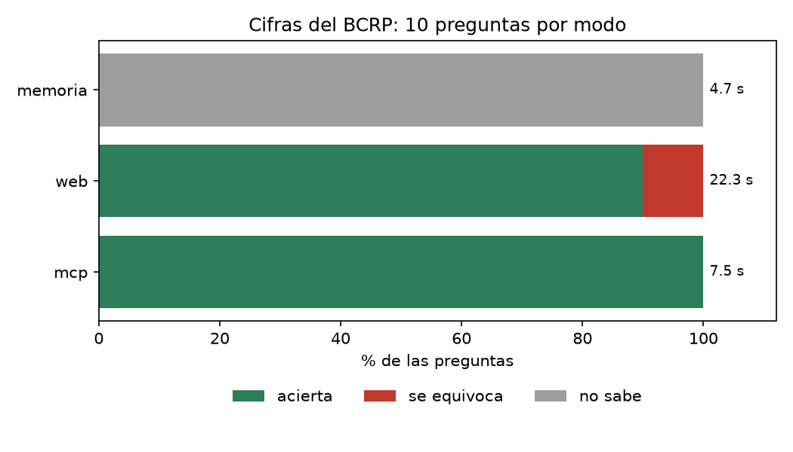

# Informe · ¿Cuántas cifras del BCRP acierta Claude sin y con su MCP?

Servidor MCP propio (`server.py`, FastMCP 4) con cuatro herramientas (`buscar_series`, `serie`, `resumen` y
`correlacion`), dos recursos (`bcrp://serie/{codigo}` y `bcrp://series/clave`) y un prompt (`informe`). Las 8 pruebas
de `test_server.py` pasan (`uv run pytest -q` → 8 passed). La evaluación se hizo con `evaluar.py`, Claude Haiku y
10 preguntas: las 8 del curso y 2 propias (`tc_prom_set26` y `subyacente_set26`).

## Resultados

Corrida base (`resultados_base.csv`, `uv run evaluar.py`):

| Modo | Acierta | Se equivoca | No sabe | Segundos promedio |
|---|---|---|---|---|
| memoria | 0 | 0 | 10 | 4.8 |
| mcp | 10 | 0 | 0 | 7.4 |

Experimento extra, contra la búsqueda web (`resultados.csv`, `uv run evaluar.py --modos memoria web mcp`):

| Modo | Acierta | Se equivoca | No sabe | Segundos promedio |
|---|---|---|---|---|
| memoria | 0 | 0 | 10 | 4.7 |
| web | 9 | 1 | 0 | 22.3 |
| mcp | 10 | 0 | 0 | 7.4 |



## Qué falló cada modo y por qué

**Memoria (0 de 10).** Las 10 respuestas fueron «no sé» (valor null). Todas las preguntas piden cifras de 2025 y
2026, posteriores o muy cercanas a la fecha de corte del modelo, y la instrucción le permitía responder null si no
estaba seguro. Haiku no inventó ninguna cifra: reconoció que no sabía.

**Web (9 de 10).** Falló `cobre_ago26`: respondió 651.45 centavos de US$ por libra cuando la cifra oficial es 689.70
(serie PN38784BM), una diferencia de unos 38 centavos, fuera de la tolerancia de 3.5. Lo más probable es que haya
tomado otra fuente o una cotización distinta del promedio mensual del BCRP (por ejemplo, un precio de un día o de otra
bolsa); la columna `fuente` de `resultados.csv` registra de dónde la sacó. Además, `pbi_2025` acertó por poco: dio
3.44 contra 3.4306, dentro de la tolerancia de 0.05, porque usó una cifra redondeada. Fue también el modo más lento:
22.3 s por pregunta, tres veces más que con el MCP.

**MCP (10 de 10).** Acertó todas, incluidas las dos preguntas propias, y cada respuesta trae el código de la serie y la
URL de la API como fuente. Acierta porque no recuerda ni busca la cifra: la pide a la fuente oficial y las cuentas las
hace Python.

## Dos cifras comprobadas fuera del MCP

Las cifras de las dos preguntas propias se obtuvieron consultando directamente la API pública del BCRP, sin pasar por
`server.py` ni por Claude:

```
curl -s "https://estadisticas.bcrp.gob.pe/estadisticas/series/api/PN01206PM-PN01279PM/json/2026-9/2026-9"
```

| Pregunta | Serie | Periodo | Cifra del BCRP | Respuesta del MCP |
|---|---|---|---|---|
| Tipo de cambio interbancario venta, promedio del mes (S/ por US$) | PN01206PM | 2026-09 | 3.383 | 3.383082 |
| Inflación subyacente a 12 meses, Lima Metropolitana (%) | PN01279PM | 2026-09 | 2.85 | 2.85 |

Las mismas cifras pueden verse en las tablas web del BCRP:

- https://estadisticas.bcrp.gob.pe/estadisticas/series/mensuales/resultados/PN01206PM/html/2026-9/2026-9/
- https://estadisticas.bcrp.gob.pe/estadisticas/series/mensuales/resultados/PN01279PM/html/2026-9/2026-9/

## Herramienta propia: `correlacion`

Calcula la correlación de Pearson entre dos series de la misma frecuencia en los periodos que ambas tienen, y devuelve
las dos fuentes. Probada en Claude Code: entre 2015-01 y 2025-12, la inflación a 12 meses (PN01273PM) y el tipo de
cambio promedio mensual (PN01206PM) tienen r = 0.52 con 132 meses, una asociación moderada positiva. Claude advirtió
con razón que compara un nivel con una tasa de variación, por lo que sería más correcto correlacionar la inflación con
la variación a 12 meses del tipo de cambio.

## Conclusión

Sin herramientas, el modelo no conoce cifras recientes, aunque al menos reconoce que no sabe. La búsqueda web resuelve
la mayoría de las preguntas, pero es tres veces más lenta y puede tomar una cifra de una fuente distinta, como pasó con
el cobre, sin que se note en la respuesta. Construir un MCP vale la pena cuando se consulta con frecuencia una misma
fuente oficial y la cifra exacta importa: da la cifra de la fuente, con su código y su URL, y hace las cuentas sin
error. Para una consulta aislada o sobre temas sin una fuente estructurada, basta la búsqueda web, verificando la
fuente que cita.
